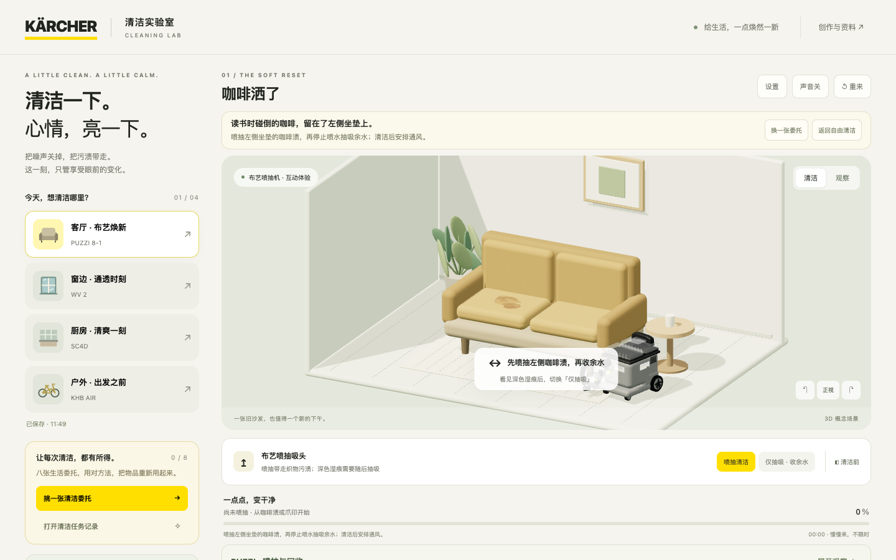
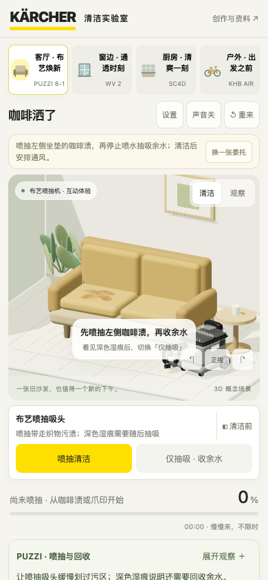

# 作品提交说明

作品名称：清洁一下 · 卡赫 3D 清洁实验室  
项目形态：可离线运行的 Web 3D 清洁解压游戏  
技术：Three.js 0.180.0、原生 JavaScript、Web Audio、Canvas 污层、esbuild

## 体验顺序

1. 打开根目录 index.html。首次进入「咖啡洒了」，观察 Puzzi 喷抽留下的深色湿痕，再切换仅抽吸。
2. 从产品入口切换 WV 2，观察干手印与湿污膜，选择喷、擦或吸。
3. 体验 SC4D 蒸汽松动油垢、KHB Air 分部位冲洗自行车；打开产品模型查看参考图与三维结构。
4. 完成后欣赏干净场景，收下知识/故事卡，查看清洁成果卡或选择下一单。

## 主要设计

- 用真实产品作用区分玩法：辅助预清洁、电动吸液、喷抽回收、蒸汽松动与户外冲洗。
- 用污渍、水分和局部残留引导判断，没有额外堆叠无关谜题、签到或付费抽取。
- 图文卡引用官方信息；每款产品首次完成给对应知识卡，后续鼓励探索未收集内容。
- 支持触屏、键盘、轻松擦洗、减少动画和流畅画质；进度和偏好在本机保存。

## 提交内容

当前目录包含源码、已构建游戏、四款模型导出、运行素材、出处与许可证、核心测试。上传前如需压缩，请压缩整个 kahegame 文件夹，并保持解压后的目录结构。

开发缓存、编辑器配置、历史调研网页、旧截图、测试产物和修改前备份已移到项目外的开发归档中，不属于提交内容。无需提交 node_modules，依赖可由 package-lock.json 恢复。

## 验证范围

核心状态、旧存档、普通卡与独立 1% 金卡逻辑有自动化回归。既有版本完成过四产品代表任务的真实鼠标/模拟触屏验证；本次整理重点检查构建、资源引用、说明书路径和页面基本交互。

真人耳机/外放试听、中端手机温升与帧率、新玩家访谈尚未完成。金卡为试玩演示，不承诺实物兑奖。具体设备操作与材质适用性以产品说明书为准。

## 预览

桌面：

手机：

